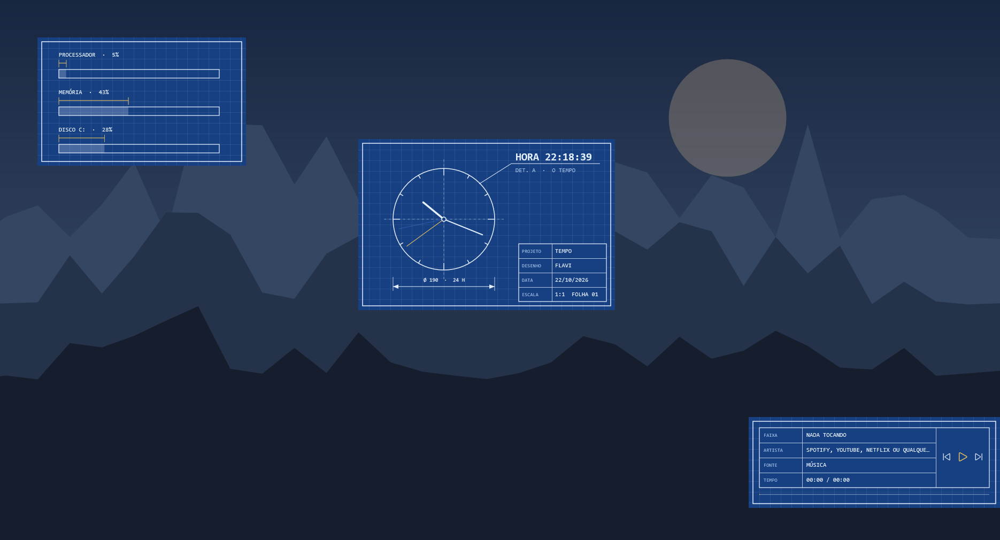
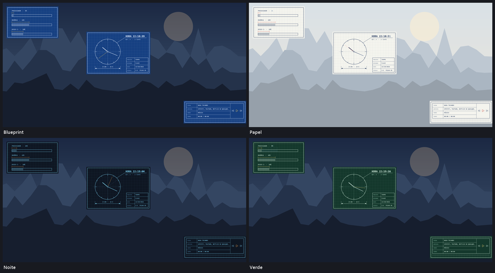
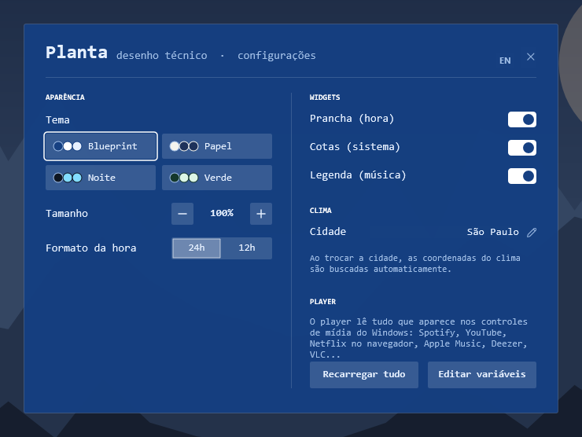

# Planta

**Desenho técnico azul: relógio com cotas, sistema como peças cotadas e música como legenda.**

*Blueprint — Blue technical drawing: a dimensioned clock, system as parts and music as a title block.*

Skin para o [Rainmeter](https://www.rainmeter.net), minimalista, com tela de configurações própria e em **português e inglês**.
· [English below](#english)

[**⬇ Baixar / Download Planta.rmskin**](https://github.com/flavioferr/rainmeter-planta/releases/latest/download/Planta.rmskin)

## Widgets

| Widget | O que mostra |
|---|---|
| **Prancha (hora)** | Relógio desenhado como prancha técnica: linhas de centro, cotas, chamada com a hora e carimbo com a data. |
| **Cotas (sistema)** | Processador, memória e disco como peças cotadas num desenho técnico. |
| **Legenda (música)** | A música como legenda de prancha: faixa, artista, fonte e tempo numa tabela, com a cota de progresso e os controles. |

## Temas

4 temas prontos: Blueprint, Papel, Noite, Verde.

## Configurações

Clique com o botão direito em qualquer widget → **Configurações**. Tudo é salvo na hora.

- Tema (4 opções)
- Tamanho dos widgets (70% a 160%)
- Hora em 24h ou 12h
- Sua cidade (coordenadas buscadas automaticamente)
- Ligar/desligar cada widget
- Idioma: português ou inglês

## Instalação

1. Instale o [Rainmeter](https://www.rainmeter.net) (4.5 ou mais novo).
2. Baixe o [`Planta.rmskin`](https://github.com/flavioferr/rainmeter-planta/releases/latest) na página de Releases.
3. Dê dois cliques no arquivo e clique em **Install**.
4. Na primeira vez, os widgets aparecem já posicionados e as configurações abrem sozinhas.

## Dicas

- **Idioma:** botão direito em qualquer widget → **English** (ou o botão **EN** nas configurações). Para voltar, **Português**.
- **Música:** o player lê tudo que aparece nos controles de mídia do Windows — Spotify, YouTube, Netflix e qualquer site no navegador, Apple Music, Deezer, VLC… O plugin [WebNowPlaying](https://github.com/keifufu/WebNowPlaying-Rainmeter) (MIT) já vem dentro do `.rmskin`.
- **Clima:** digite sua cidade nas configurações; as coordenadas são buscadas sozinhas. Dados do [Open-Meteo](https://open-meteo.com), gratuito e sem chave de API.
- **Mover:** arraste os widgets com o mouse.

## Requisitos

Windows 10 ou 11 e Rainmeter 4.5+. As fontes usadas já vêm com o Windows 11. Se o player ficar vazio, instale o [Microsoft Visual C++ Redistributable](https://aka.ms/vs/17/release/vc_redist.x64.exe).

---

## English

**Blueprint** — Blue technical drawing: a dimensioned clock, system as parts and music as a title block.

A minimalist skin for [Rainmeter](https://www.rainmeter.net) with its own settings screen, in **English and Portuguese**.

### Widgets

| Widget | What it shows |
|---|---|
| **Sheet (time)** | Clock drawn as a technical sheet: center lines, dimensions, a callout with the time and a title block with the date. |
| **Dimensions (system)** | Processor, memory and disk as dimensioned parts in a technical drawing. |
| **Legend (music)** | The music as a drawing title block: track, artist, source and time in a table, with the progress dimension and the controls. |

### Themes

4 ready-made themes: Blueprint, Paper, Night, Green.

### Settings

Right-click any widget → **Settings**. Everything is saved instantly.

- Theme (4 options)
- Widget size (70% to 160%)
- 24 h or 12 h time
- Your city (coordinates looked up automatically)
- Turn each widget on or off
- Language: Portuguese or English

### Installation

1. Install [Rainmeter](https://www.rainmeter.net) (4.5 or newer).
2. Download [`Planta.rmskin`](https://github.com/flavioferr/rainmeter-planta/releases/latest) from the Releases page.
3. Double-click the file and click **Install**.
4. Right-click any widget and choose **English**. The whole suite switches language (and back with **Português**).

### Tips

- **Music:** the player reads everything in the Windows media controls — Spotify, YouTube, Netflix and any website in the browser, Apple Music, Deezer, VLC… The [WebNowPlaying](https://github.com/keifufu/WebNowPlaying-Rainmeter) plugin (MIT) is included in the `.rmskin`.
- **Weather:** type your city in the settings; the coordinates are looked up automatically. Data from [Open-Meteo](https://open-meteo.com), free and without an API key.
- **Move:** drag the widgets with the mouse.

### Requirements

Windows 10 or 11 and Rainmeter 4.5+. If the player stays empty, install the [Microsoft Visual C++ Redistributable](https://aka.ms/vs/17/release/vc_redist.x64.exe).

---

## Coleção / Collection

[Ampulheta](https://github.com/flavioferr/rainmeter-ampulheta), [Fusos](https://github.com/flavioferr/rainmeter-fusos), [Recibo](https://github.com/flavioferr/rainmeter-recibo), [Selo](https://github.com/flavioferr/rainmeter-selo), [Bauhaus](https://github.com/flavioferr/rainmeter-bauhaus), [Líquido](https://github.com/flavioferr/rainmeter-liquido), [Arcade](https://github.com/flavioferr/rainmeter-arcade), [Folhinha](https://github.com/flavioferr/rainmeter-folhinha), [Binário](https://github.com/flavioferr/rainmeter-binario), [Vitral](https://github.com/flavioferr/rainmeter-vitral), [Coluna](https://github.com/flavioferr/rainmeter-coluna), [Motor](https://github.com/flavioferr/rainmeter-motor), [Galeria](https://github.com/flavioferr/rainmeter-galeria), [Rotulador](https://github.com/flavioferr/rainmeter-rotulador), [Estação](https://github.com/flavioferr/rainmeter-estacao), [Isométrico](https://github.com/flavioferr/rainmeter-isometrico), [Trânsito](https://github.com/flavioferr/rainmeter-transito), [Noventa](https://github.com/flavioferr/rainmeter-noventa), [Teclas](https://github.com/flavioferr/rainmeter-teclas), [Traço](https://github.com/flavioferr/rainmeter-traco), [Ponto](https://github.com/flavioferr/rainmeter-ponto), [Margem](https://github.com/flavioferr/rainmeter-margem), [Eclipse](https://github.com/flavioferr/rainmeter-eclipse), [Silêncio](https://github.com/flavioferr/rainmeter-silencio), [Eco](https://github.com/flavioferr/rainmeter-eco), [Tinta](https://github.com/flavioferr/rainmeter-tinta), [Haste](https://github.com/flavioferr/rainmeter-haste), [Marca](https://github.com/flavioferr/rainmeter-marca), [Foco](https://github.com/flavioferr/rainmeter-foco), [Fração](https://github.com/flavioferr/rainmeter-fracao), [Matiz](https://github.com/flavioferr/rainmeter-matiz), [Sumário](https://github.com/flavioferr/rainmeter-sumario), [Morse](https://github.com/flavioferr/rainmeter-morse), [Dominó](https://github.com/flavioferr/rainmeter-domino), [Romano](https://github.com/flavioferr/rainmeter-romano), [Gnômon](https://github.com/flavioferr/rainmeter-gnomon), [Onda](https://github.com/flavioferr/rainmeter-onda), [Pêndulo](https://github.com/flavioferr/rainmeter-pendulo), [Glifo](https://github.com/flavioferr/rainmeter-glifo), [Diagonal](https://github.com/flavioferr/rainmeter-diagonal), [Letreiro](https://github.com/flavioferr/rainmeter-letreiro), [Arco](https://github.com/flavioferr/rainmeter-arco), [Código](https://github.com/flavioferr/rainmeter-codigo), [Gráfico](https://github.com/flavioferr/rainmeter-grafico), [Metrô](https://github.com/flavioferr/rainmeter-metro), [Retícula](https://github.com/flavioferr/rainmeter-reticula), [Contagem](https://github.com/flavioferr/rainmeter-contagem), [Ano](https://github.com/flavioferr/rainmeter-ano), [Sintonia](https://github.com/flavioferr/rainmeter-sintonia), [Lumen](https://github.com/flavioferr/rainmeter-lumen), [Horizon](https://github.com/flavioferr/rainmeter-horizon), [Orbit](https://github.com/flavioferr/rainmeter-orbit), [Shell](https://github.com/flavioferr/rainmeter-shell), [Folio](https://github.com/flavioferr/rainmeter-folio), [Bento](https://github.com/flavioferr/rainmeter-bento), [Prisma](https://github.com/flavioferr/rainmeter-prisma), [Linea](https://github.com/flavioferr/rainmeter-linea), [Pixel](https://github.com/flavioferr/rainmeter-pixel), [Soft](https://github.com/flavioferr/rainmeter-soft), [Swiss](https://github.com/flavioferr/rainmeter-swiss), [Island](https://github.com/flavioferr/rainmeter-island), [Divisa](https://github.com/flavioferr/rainmeter-divisa), [Serra](https://github.com/flavioferr/rainmeter-serra), [Mosaico](https://github.com/flavioferr/rainmeter-mosaico), [Painel](https://github.com/flavioferr/rainmeter-painel), [Eixo](https://github.com/flavioferr/rainmeter-eixo), [Maré](https://github.com/flavioferr/rainmeter-mare), [Bússola](https://github.com/flavioferr/rainmeter-bussola), [Lousa](https://github.com/flavioferr/rainmeter-lousa), [Console](https://github.com/flavioferr/rainmeter-console), [Régua](https://github.com/flavioferr/rainmeter-regua), [Placa](https://github.com/flavioferr/rainmeter-placa), [Brisa](https://github.com/flavioferr/rainmeter-brisa), [Pulso](https://github.com/flavioferr/rainmeter-pulso), [Seixo](https://github.com/flavioferr/rainmeter-seixo), [Estúdio](https://github.com/flavioferr/rainmeter-estudio), [Palavra](https://github.com/flavioferr/rainmeter-palavra), [Constelação](https://github.com/flavioferr/rainmeter-constelacao), [Origami](https://github.com/flavioferr/rainmeter-origami).

## Licença / License

[CC BY-NC-SA 4.0](LICENSE.md). O plugin WebNowPlaying incluído no `.rmskin` é de / the bundled WebNowPlaying plugin is by [keifufu](https://github.com/keifufu/WebNowPlaying-Rainmeter) (MIT).
